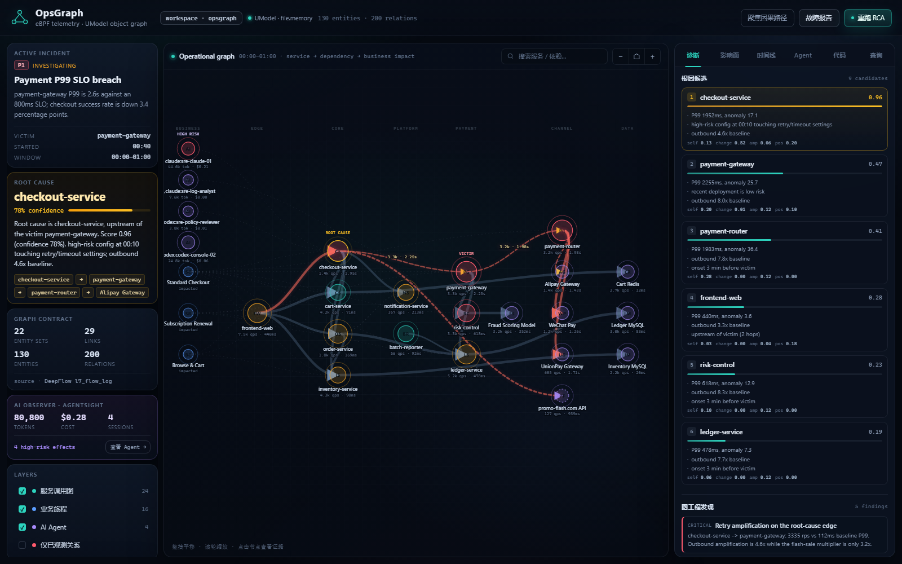
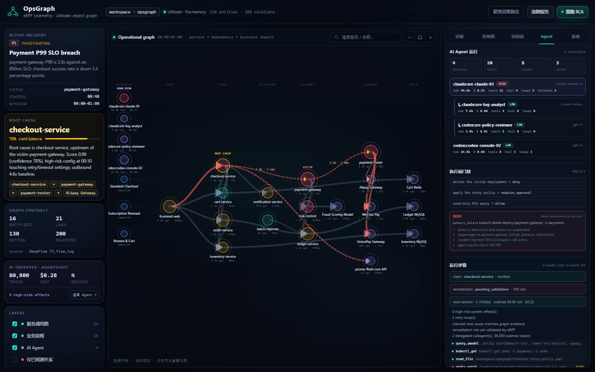
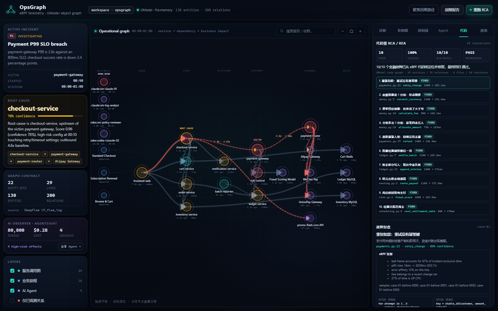

# OpsGraph · eBPF × UModel × AgentSight × Code RCA

[](https://github.com/whllowp/opsgraph/actions/workflows/ci.yml)

> GitHub: [whllowp/opsgraph](https://github.com/whllowp/opsgraph)
>
> 把 eBPF 观测到的服务调用、AI Agent 行为与代码栈，编译成 UModel 上可查询、可推理、可回写的运维对象图。
> 不止定位到服务，还要定位到代码行，并用「伪代码 → 补丁 → 金融回归 → eBPF 复测」闭环修复。



## 为什么需要 Graph Engineering

传统运维拓扑通常有三个断点：

1. **图是画出来的，不是算出来的。** CMDB 里的依赖靠人填，和真实流量长期漂移。
2. **边没有证据。** 一条 `A -> B` 的线，说不清 QPS、P99、错误率、起始时间，也说不清是声明还是观测。
3. **图不能推理。** 有拓扑但回答不了「为什么是它」「影响哪些业务」「摘掉它会怎样」。

AI 时代多了第四个断点：**Agent 是新的变更执行者，但它的行为不在图里。**

- Agent 读了哪些文件、调了哪些命令、连了哪些服务？
- 它声称的根因，和 eBPF/UModel 图上的证据一致吗？
- 它是在排查故障，还是在制造新的变更风险？
- 一次 Agent 运行消耗了多少 token、触发了几次重试环、影响了哪些生产对象？

OpsGraph 用 **DeepFlow eBPF** 构建服务事实边，用 **AgentSight eBPF** 构建 Agent 决策/效果边，用 **UModel** 固化对象与关系，用 **图算子** 做因果排序、爆炸半径、影子依赖、Agent 重试环与结论校验。所有结论都能回到一条 UModel 查询和一组内核观测。

## 四层架构

```
        ┌──────────────────────────────┐        ┌─────────────────────────────────┐
        │  DeepFlow agent (eBPF)       │        │  AgentSight (eBPF + TLS)        │
        │  L7 flow · tags · node metrics│        │  session · tool · file/net/proc │
        └──────────────┬───────────────┘        └────────────────┬────────────────┘
                       │ replay CSV / querier API                │ snapshot.json / SQLite
                       ▼                                         ▼
┌─────────────────────────────┐   ┌──────────────────────────┐   ┌──────────────────────────┐
│ 1. Observe                  │   │ 2. Model                 │   │ 3. Materialize           │
│ DeepFlow + AgentSight       │──►│ UModel pack              │──►│ service graph + AI graph │
│ normalize / window          │   │ 22 EntitySet / 29 Link   │   │ evidence on edges        │
└─────────────────────────────┘   └──────────────────────────┘   └────────────┬─────────────┘
                                                                              │
                                           ┌──────────────────────────────────▼─────────────┐
                                           │ 4. Reason                                      │
                                           │ service RCA · blast radius · drift · SPOF      │
                                           │ agent risk · retry loop · claim verification   │
                                           └──────────────────────────────────┬─────────────┘
                                                                              │
                    ┌─────────────────────────────────────────────────────────┼──────────────────────────────┐
                    ▼                                                         ▼                              ▼
             UModel Query Service                                    Graph Console                  Markdown report
             `.entity` / `.topo` / `.umodel`                         (service + AI lanes)           (incident-report.md)
```

## 5 分钟运行

### 前置条件

- Python 3.11+（依赖仅 `requests`）
- Go 1.22+（构建 UModel server）
- 同目录下的 [`UnifiedModel`](../UnifiedModel) 仓库
- Windows PowerShell 7+（下面的脚本；Linux/macOS 可用手动命令）

### 一键启动

```powershell
cd E:\ebpf\opsgraph
.\run-demo.ps1
```

脚本会：

1. 构建/启动 UModel（`file.memory`，`127.0.0.1:18080`）；
2. 生成 DeepFlow 形态的服务回放与 AgentSight 形态的 Agent 会话；
3. 导入 UModel 模型包，写入 130 个服务实体 / 200 条关系；
4. 运行服务 RCA + Agent 风险/重试环/结论校验，并把角色回写 UModel；
5. 运行 10 次代码级 RCA → 伪代码 → 补丁 → 金融回归 → eBPF 复测，并写入 47 个代码实体 / 76 条代码关系；
6. 启动控制台 `http://127.0.0.1:18088`。

停止：

```powershell
.\stop-demo.ps1
```

### 手动运行

```powershell
# 1. 启动 UModel（--import-root 必须覆盖本项目目录）
E:\ebpf\bin\umodel-server.exe --graphstore file.memory `
  --data .runtime\umodel --addr 127.0.0.1:18080 --import-root E:\ebpf\opsgraph

# 2. 生成回放 + 导入模型 + 写入实体关系 + RCA
python -m opsgraph demo --addr http://127.0.0.1:18080

# 3. 代码级 RCA + 10 次 REA 闭环
python -m opsgraph code-demo

# 4. 打开图控制台
python -m opsgraph serve --port 18088
```

## Demo 里会发生什么

场景：**一次 checkout retry 配置变更，在 Flash Sale 流量下放大成 payment-gateway 的 P99 SLO 故障。**

| 时间 | 事件 |
|---|---|
| 23:50 | `payment-gateway v3.2.1` 部署，只改日志格式（红鲱鱼） |
| 00:05 | Flash Sale 开始放量，3.2x |
| 00:10 | `checkout-service` 重试策略 `max_retries 2 -> 5`、超时 `500ms -> 2000ms` |
| 00:10 | checkout 出向流量开始放大（早于时延） |
| 00:13 | payment-gateway / payment-router P99 同步抬升 |
| 00:19 | Alipay 5xx 开始上升 |
| 00:20 | node-3 CPU 92%（batch-reporter 造成，不在支付路径） |
| 00:40 | SLO burn-rate 告警，进入事故 |
| 00:44 | SRE Agent（Claude）开始排查，查询 UModel、读取 retry 配置 |
| 00:45 | 委派 `sre-log-analyst`（Haiku）读 payment-gateway 日志，定位 retry/timeout 信号 |
| 00:46 | 委派 `sre-policy-reviewer`（GPT-5）审查 retry 配置变更 |
| 00:47 | Agent 写入 `checkout-retry-policy.yaml`，前两次 `apply_patch` 被拒后重试成功 |
| 00:50 | Agent `kubectl apply` 到 prod，前两次 forbidden，第三次成功 |
| 00:54 | Agent 验证 SLO，P99 仍 2.2s → remediation pending |

OpsGraph 的输出：

```text
Root cause: checkout-service  (confidence 78%)
Victim:     payment-gateway
Path:       checkout-service -> payment-gateway -> payment-router -> Alipay Gateway

#1 checkout-service  0.96   high-risk config @00:10 + outbound 4.6x + upstream of victim
#2 payment-gateway   0.47   victim, anomalous but no risky change
#3 payment-router    0.41   downstream, no change, anomaly fully explained by upstream

Agents: 4 sessions · 20 tool calls · 80,800 tokens · $0.28 · 3 retry loops · 2 delegations
Baseline: 8 historical runs · claim accuracy 6/8
Gate: deny / require_approval / allow
```

图工程发现：

- **retry-storm**：checkout → payment-gateway 达 3.3k rps，是基线的 8x，而 Flash Sale 只解释 3.2x；多出来的约 2.5x 来自重试放大。
- **shadow-dependency**：`checkout-service -> api.promo-flash.com` 只被 eBPF 观测到，CMDB 中没有声明。
- **declared-unobserved**：`order-service -> notification-service` 在 CMDB 中声明，但窗口内 0 请求。
- **single-point-of-failure**：服务图的割点，摘除会导致调用链断开。
- **node-pressure（已排除）**：node-3 CPU 92%，但 payment-gateway 没有 Pod 在该节点。
- **agent-retry-loop**：SRE Agent 的 `apply_patch` 与 `kubectl_apply` 各重试 3 次（2 次失败），累计 2 个重试环。
- **agent-risky-effects**：Agent 写入 prod retry 配置、执行 `kubectl apply` / `kubectl rollout`，共 4 个高风险系统效果。
- **agent-claim-verified**：Agent 声称根因 `checkout-service`，与 UModel 图 RCA 一致（verified）。
- **agent-remediation-pending**：Agent 已重启服务，但同窗口 eBPF 仍显示 payment-gateway P99 2.2s，处置未验证。
- **agent-delegation**：SRE 主 Agent 委派 2 个子 Agent，子树 56,000 token / $0.22，子树最高风险 100。
- **agent-baseline-spike**：SRE 当前 44.6k token、4 次失败、2 个重试环均高于历史 p95（31.6k / 2.8 / 1.0）。
- **gate**：`kubectl delete payment-gateway` → deny；`kubectl apply retry-policy` → require_approval；只读查询 → allow。

完整报告：`artifacts/incident-report.md`；Agent 专项数据：`artifacts/agents.json`、`artifacts/baseline.json`、`artifacts/policy.json`。

## 图模型：22 个实体集 / 29 条关系

模型定义在 `model/`，由 `opsgraph/ontology.py` 生成；导入后可在 UModel 里按 `.umodel` 查询。

| 域 | 实体集 | 关键字段 |
|---|---|---|
| infra | `infra.cluster` / `infra.node` / `infra.namespace` / `infra.workload` / `infra.pod` | CPU、AZ、Pod、镜像、副本 |
| svc | `svc.service` | QPS、P99、错误率、基线、异常分、onset、角色、变更风险 |
| svc | `svc.endpoint` | method/path、QPS、P99、错误率 |
| svc | `svc.external_service` | 域名、类型、声明状态、shadow 标记 |
| biz | `biz.journey` | 等级、转化影响、营收敞口、是否受影响 |
| ops | `ops.incident` / `ops.change` / `ops.alert` | 严重级别、时间、变更摘要、根因回写 |
| ai | `ai.agent_session` | Agent 类型、模型、tokens、成本、工具/失败/重试环、风险分、claim 校验、父子委派与子树汇总 |
| ai | `ai.model` | provider/model、调用数、tokens、成本 |
| ai | `ai.tool_call` | 工具名、输入/输出摘要、目标、状态、重试序号、风险 |
| ai | `ai.effect` | 文件/进程/网络/模型效果、目标、风险、置信度 |
| code | `code.repository` / `code.file` / `code.function` / `code.line` | 仓库、文件、函数、被 eBPF 归因的代码行 |
| code | `code.issue` / `code.patch` | 代码级故障、伪代码/补丁、回归与 eBPF 复测 |

关系：`contains`、`scheduled_on`、`runs_as`、`exposes`、`calls`、`calls_endpoint`、`depends_on`、`affects`、`targets`，以及 AI 域的 `uses_model`、`invokes`、`produces`、`acts_on`、`investigates`、`delegates_to`，代码域的 `has_line`、`observed_in`、`fixes`、`modifies`。

**边即证据。** `calls` 关系自带：

```json
{
  "rps": 3334.7,
  "error_rate": 0.0116,
  "latency_p99_ms": 2255.2,
  "baseline_p99_ms": 110.4,
  "p99_delta_pct": 1915.4,
  "onset_ts": 1793549580,
  "observed": true,
  "declared": true,
  "shadow": false,
  "evidence": "deepflow.l7_flow_log",
  "confidence": 0.98
}
```

## eBPF → UModel 映射

| DeepFlow 通用标签/指标 | OpsGraph 落点 |
|---|---|
| `pod_service_0` / `pod_service_1` | `svc.service`（客户端/服务端） |
| `pod_0` / `pod_1` | `infra.pod` |
| `pod_ns_0` / `pod_ns_1` | `infra.namespace` |
| `pod_node_0` / `pod_node_1` | `infra.node` |
| `request_domain` + `is_internet_1` | `svc.external_service`（含未声明的 shadow 依赖） |
| `endpoint` + `request_type` | `svc.endpoint` |
| `request` / `rrt_p99` / `client_error` / `server_error` | 关系上的 QPS / P99 / 错误率 |
| `tap_side='server'` | 去重，避免客户端与服务端双计 |

实时接入：

```powershell
$env:DEEPFLOW_API_BASE = "http://deepflow-server:20416"
python -m opsgraph demo --source deepflow
```

`opsgraph/deepflow.py` 中的 SQL 直接查询 `flow_log.l7_flow_log`，按分钟与通用标签聚合；详见 [DeepFlow 接入](docs/deepflow.md)。

## AI 时代：Agent 也是一等图节点

AgentSight 从系统边界观测 Agent，不要求 SDK/代理：

- LLM 调用与 token：`llm_calls` / `token_usage`
- 工具决策：`tool_calls`（工具名、输入、状态、时长、related_pid）
- 系统效果：`audit_events`（file/process/network/llm）+ `process_nodes` + `network_targets`
- 资源：`resource_samples`
- 会话：`sessions` / `token_summary`

OpsGraph 把四类 AI 对象接进 UModel：

```text
ai.agent_session --uses_model--> ai.model
ai.agent_session --invokes----> ai.tool_call --produces--> ai.effect
ai.agent_session --delegates_to-> ai.agent_session
ai.agent_session --acts_on----> svc.service
ai.agent_session --investigates-> ops.incident
ai.effect        --affects----> svc.service
```

每条 `ai.*` 边都带证据：token、成本、工具状态、重试序号、风险、置信度、`source=agentsight.*`。



### Agent 图算子

| 算子 | 回答的问题 |
|---|---|
| `agent_risk` | 这次 Agent 运行碰了哪些高风险文件/命令/生产环境？ |
| `agent_loop` | 哪些工具在同一目标上连续失败/重试，烧了多少 token？ |
| `agent_blast_radius` | Agent 读了/写了哪些文件、连了哪些 host、影响了哪些服务？ |
| `agent_cost` | token/成本如何归因到 session、model、incident？ |
| `agent_claim_check` | Agent 声称的根因，与 UModel 图 RCA 是否一致？ |
| `agent_remediation_check` | Agent 的处置动作，是否被 eBPF 指标验证？ |
| `agent_delegation` | 主 Agent 委派了哪些子 Agent，子树 token/成本/风险是多少？ |

### 多 Agent 协作图

AgentSight session 支持 `parent_session_id` 后，OpsGraph 建立自环：

```text
ai.agent_session --delegates_to--> ai.agent_session
```

并计算 `depth`、`child_sessions`、`subtree_tokens`、`subtree_cost_usd`、`subtree_risk_score`。父会话的 token/成本不再漏算子 Agent，子树最高风险会抬升父会话风险。详见 [多 Agent 协作](docs/agent-collaboration.md)。

### 执行前策略门禁

不是所有高风险动作都要等到事后 finding。`opsgraph/policy.py` 在图上下文上做 pre-flight：

```bash
python -m opsgraph gate --session sre-claude-01 \
  --tool kubectl_delete \
  --target "kubectl delete deploy/payment-gateway -n payments"
```

决策为 `allow` / `require_approval` / `deny`，并返回目标服务、事故状态、命中规则、审批人和图证据。控制台 `Agent` tab 的「执行前门禁」面板可直接试。详见 [执行前策略门禁](docs/policy-gate.md)。

### 历史基线与 Claim Accuracy

`data/history/agent_history.json` 保存历史 Agent 运行摘要。`opsgraph/history.py` 计算：

- token / 成本 / 工具 / 失败 / 重试环 / 时长的 median、p95、偏离；
- 当前运行相对同 Agent 历史的 token spike、loop spike；
- 历史 `claim_correct` + 当前 `claim_status` 的 claim accuracy。

Demo：8 条历史运行，总体 claim accuracy **6/8 = 75%**；SRE Agent 当前 44.6k token、4 次失败、2 个重试环均高于历史 p95，生成 `agent-baseline-spike`。详见 [Agent 基线与评估](docs/agent-evaluation.md)。

### 接入真实 AgentSight

```bash
# 1) 在 Linux 上录制一次 Agent 运行（需要 eBPF 权限）
sudo agentsight record -- claude

# 2) 导出 JSON 快照
agentsight report export -o agentsight_snapshot.json

# 3) 编译进 UModel 图
python -m opsgraph demo --agentsight agentsight_snapshot.json
```

也支持直接读取 `agentsight-*.db`：

```bash
python -m opsgraph demo --agentsight agentsight-2026-11-02.db
```

AgentSight 快照包含 prompt、路径、命令等敏感内容。OpsGraph 只把摘要、风险与派生指标写入图；原始内容不要提交到仓库。详见 [AgentSight 接入](docs/agentsight.md)。

## 代码级 RCA / REA：从 eBPF 栈到修复闭环

服务 RCA 回答「哪个服务」，代码 RCA 回答「哪一行」。代码栈样本长这样：

```json
{
  "kind": "oncpu",
  "duration_us": 2800000,
  "error": true,
  "stack": [
    {"symbol": "server.handle_request", "file": "server.py", "line": 8},
    {"symbol": "payments.py:retry_charge", "file": "payments.py", "line": 22}
  ]
}
```

OpsGraph 按 `file:line` 聚合独占时间、p95 放大、错误亲和度、变更命中与 off-CPU 占比，输出代码行根因、置信度、证据样本和调用图。**RCA 不读取测试名/补丁/预期答案**。

### REA：Remediation Engineering Automation

10 个金融故障，10 次闭环：

```text
eBPF code stack -> 代码行 RCA -> 伪代码 before/after -> 补丁
                -> 该故障回归 -> 全量回归 -> eBPF P99/错误率复测
                -> 通过保留 / 失败回滚 -> 下一个故障
```

结果：

```text
10/10 fixed
10/10 RCA matches
final regression PASS
```

覆盖：重复扣款、换汇精度、费率边界、分账误差、退款去重、分页漏单、账本原子写、出款路由、风控超时、结算日周末。



控制台「代码」tab 用小白语言回答四件事：

- 发生了什么：客户被重复扣款 / 换汇少 1 分 / 结算漏单；
- 为什么：重试没有幂等键 / 浮点精度 / 分页提前退出；
- 怎么修：伪代码 before/after；
- 怎么验证：金融回归 + eBPF P99/错误率回落。

```bash
python -m opsgraph code-demo
```

产物：

- `data/code_rca/ebpf_samples.json`：eBPF 代码栈回放；
- `artifacts/code_rca.json`：10 次迭代、RCA、伪代码、测试、复测；
- `artifacts/code_graph.json`：47 个代码实体 / 76 条代码关系（写入 UModel）；
- `artifacts/code-rca-report.md`：面向人的报告；
- `artifacts/code-fixes.patch`：累计补丁。

真实 eBPF 栈可先导出再接入：

```bash
sudo perf record -F 99 -g --call-graph dwarf -p <pid> -- sleep 30
sudo perf script > perf-stacks.txt
python -m opsgraph code-ingest --input perf-stacks.txt --case case-01
```

详见 [代码级 RCA / REA](docs/code-rca.md)。

## 图工程算子

| 算子 | 输入 | 输出 | 说明 |
|---|---|---|---|
| `materialize` | L7 flow + k8s 快照 | 实体/关系批次 | 稳定 ID、证据字段、观测/声明对账 |
| `rca` | 受害服务 + 异常边 | 候选排序 + 置信度 | 自身严重度、变更关联、出向放大、因果领先、图位置 |
| `blast_radius` | 根因 | 服务/业务旅程/峰值 QPS | 沿 `calls` 正向可达 |
| `drift` | 观测边 vs 声明边 | shadow / unobserved | 双向差异，不静默丢边 |
| `spof` | 服务调用图 | 割点 | Tarjan |
| `critical_path` | 受害服务 | 高 P99 路径 | 用于定位最贵的一段 |
| `simulate` | 待摘除服务 | 受影响服务 | 控制台按钮，调 `/api/simulate` |

RCA 评分不是黑盒：

```text
score = 0.28 * self_severity
      + 0.52 * change_affinity      # 高风险变更 + 距放大起点 < 20min
      + 0.12 * outbound_amplification
      + 0.08 * causal_lead
      + 0.07 * propagation
      + 0.20 * graph_position       # 位于受害服务上游
```

控制台会展示每一项的分值；详见 [Graph Engineering](docs/graph-engineering.md)。

## 常用命令

```powershell
python -m opsgraph demo --addr http://127.0.0.1:18080   # 全链路（含 AgentSight demo）
python -m opsgraph demo --agentsight agentsight_snapshot.json
python -m opsgraph demo --no-agents                     # 只跑服务图
python -m opsgraph code-demo                            # 10 次代码 RCA/REA 闭环
python -m opsgraph code-ingest --input perf-stacks.txt --case case-01
python -m opsgraph analyze --source umodel              # 从 UModel 重新读图分析
python -m opsgraph rca                                  # 打印根因排序
python -m opsgraph gate --session sre-claude-01 --tool kubectl_apply \
  --target "kubectl apply -f checkout-retry-policy.yaml -n shop"
python -m opsgraph baseline                             # 历史基线 + claim accuracy
python -m opsgraph serve --port 18088                   # 控制台
python -m opsgraph doctor                               # UModel 连通性/计数
python -m opsgraph query ".entity with(domain='svc', name='svc.service') | limit 5"
python -m unittest discover -s tests -v                 # 50 个单测
```

## UModel 查询示例

```bash
# 受害服务
umctl --addr http://127.0.0.1:18080 query run opsgraph \
  ".entity with(domain='svc', name='svc.service', query='payment-gateway')"

# 读取 checkout 的直接调用边（含证据）
umctl --addr http://127.0.0.1:18080 query run opsgraph \
  '.topo | graph-call getDirectRelations([(:"svc@svc.service" {__entity_id__: "<checkout-id>"})])'

# 用 Cypher 拉完整证据图
umctl --addr http://127.0.0.1:18080 query run opsgraph \
  ".topo | graph-call cypher(\`MATCH (src)-[r]->(dest) RETURN src, r AS relation, dest LIMIT 100\`)"
```

## 目录

```
opsgraph/
├── opsgraph/
│   ├── scenario.py        # 确定性 DeepFlow 回放（含红鲱鱼/影子依赖）
│   ├── deepflow.py        # replay + live querier 适配
│   ├── agentsight.py      # AgentSight snapshot/SQLite 适配
│   ├── agentsight_demo.py # 确定性 AgentSight 会话
│   ├── agent_graph.py     # Agent 会话/工具/效果 -> UModel 图（含委派树）
│   ├── policy.py          # 执行前策略门禁
│   ├── history.py         # 历史基线与 claim accuracy
│   ├── code_cases.py      # 10 个金融故障、补丁与伪代码
│   ├── code_rca.py        # eBPF 代码栈 RCA + REA 闭环
│   ├── code_graph.py      # 代码域 -> UModel 实体/关系
│   ├── ebpf_stacks.py     # perf/bpftrace 栈文本接入
│   ├── ontology.py        # 图契约：22 EntitySet + 29 Link
│   ├── model_pack.py      # 生成 UModel 模型包
│   ├── materialize.py     # 观测 -> 实体/关系（证据边）
│   ├── analysis.py        # RCA / 影响面 / 漂移 / SPOF
│   ├── pipeline.py        # 全链路编排 + 报告
│   ├── console_server.py  # 控制台 API + 静态服务
│   ├── umodel_client.py   # UModel 公共 REST 客户端
│   └── cli.py
├── model/                 # 生成的 UModel 模型包
├── demo/fintech/          # 金融故障代码库 + 10 个回归用例
├── data/replay/           # l7_flow_log.csv / agentsight_snapshot.json
├── data/history/          # agent_history.json（历史基线）
├── data/code_rca/         # eBPF 代码栈回放
├── console/               # 零依赖 SVG 图控制台（服务 + AI lane + 代码）
├── artifacts/             # snapshot / analysis / agents / code_rca / report
├── docs/
├── tests/
└── run-demo.ps1
```

## 验证

```powershell
python -m unittest discover -s tests -v
python -m opsgraph doctor
```

`verification.json` 会对比本地快照与 UModel 回读：

```json
{
  "declared_entities": 130,
  "umodel_entities": 130,
  "declared_relations": 200,
  "umodel_relations": 200,
  "root_cause_field": "checkout-service",
  "agent_sessions": 4,
  "agent_tool_calls": 20,
  "agent_effects": 17,
  "agent_delegations": 2
}
```

代码级闭环验证：

```powershell
python -m opsgraph code-demo
```

输出应为：`10/10 fixed`、`10/10 RCA matches`、`final suite PASS`；详细结果在 `artifacts/code_rca.json`。  
UModel 代码图：`22 EntitySet / 29 Link`，`47` 个代码实体 / `76` 条代码关系。

## 设计边界

- **DeepFlow 是可替换的传感器。** 只要能把 L7 调用聚合到「客户端服务、服务端服务/域名、端点、时间、QPS、P99、错误」这些维度，就可以替换 `deepflow.py` 的适配层。
- **AgentSight 是可替换的 Agent 传感器。** 当前消费其 JSON snapshot 与 SQLite schema v1；换其他 Agent 遥测只需产出同样的 `sessions` / `tool_calls` / `effects`。
- **UModel 是唯一读路径。** 控制台与 CLI 读取都通过 UModel Query Service；本地 `snapshot.json` 只是同一批写入数据的分析快照。
- **RCA 是可解释的。** 当前是规则 + 因果图排序，不是黑盒模型；每个分值都有对应证据字段。
- **Agent 结论不是事实。** `claim_status` 只表示 Agent 声称与图 RCA 是否一致；`remediation_status=pending_validation` 表示行动尚未被 eBPF 指标验证。
- **Gate 当前是建议性的。** `require_approval`/`deny` 不会劫持 Agent 的 syscall；要强制执行必须接 tool proxy、MCP server 或 admission controller。
- **历史基线是合成数据。** `data/history/agent_history.json` 仅用于离线演示；生产应写入真实根会话摘要并回填图 RCA 结果。
- **代码栈当前是回放。** `data/code_rca/ebpf_samples.json` 是可复现的 eBPF 用户态栈样本；真实采集需要 Linux perf/bpftrace/DWARF，可用 `code-ingest` 接入。
- **REA 不自动改生产。** 补丁只在临时 worktree 应用并跑测试；高风险资金改动仍需门禁与人工审批。
- **代码图只物化命中的位置。** 当前 10 个故障对应 6 个文件、10 个函数、10 行、10 个补丁，不是整仓 AST 图。
- **敏感数据默认不图化。** AgentSight 快照可能含 prompt、路径、命令；写入图的是摘要与派生风险，原始快照不应提交到 Git。
- **不是生产级采集器。** 生产化需要处理多集群、采样、卡片性、权限、长期存储与告警闭环；这些在 [架构文档](docs/architecture.md) 的「下一步」中列出。

## License

Apache-2.0。示例中的服务名、IP、指标均为合成数据。
