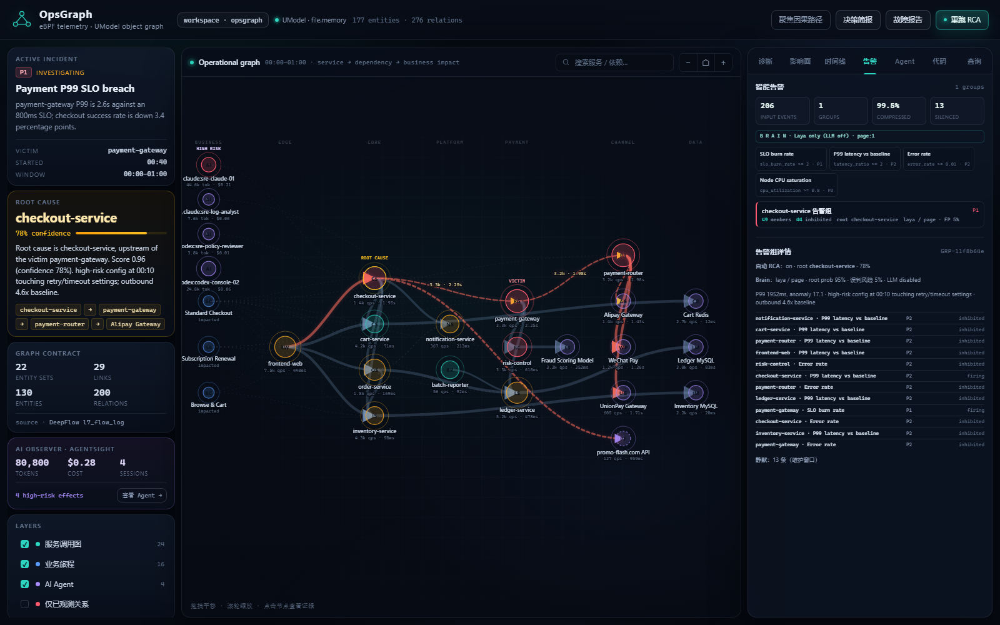

# 智能监控告警

> 目标不是“发更多告警”，而是“把 206 条信号压成 1 个可执行根因组”。



## 策略配置

策略是代码化配置：[config/alert_policies.json](../config/alert_policies.json)。

```json
{
  "id": "slo-burn",
  "name": "SLO burn rate",
  "metric": "slo_burn_rate",
  "target_type": "svc.service",
  "operator": ">=",
  "threshold": 2.0,
  "severity": "P1",
  "dedupe_window_seconds": 300,
  "inhibit_downstream": true,
  "auto_rca": true
}
```

内置策略：

| 策略 | 指标 | 阈值 | 级别 | 自动 RCA |
|---|---|---:|---|---|
| SLO burn rate | `slo_burn_rate` | 2.0 | P1 | yes |
| P99 latency | `latency_ratio` | 2.0 | P2 | yes |
| Error rate | `error_rate` | 0.01 | P2 | yes |
| Node CPU | `cpu_utilization` | 0.8 | P3 | no |

CLI 可查看/修改：

```bash
python -m opsgraph alert-policy --list
python -m opsgraph alert-policy --id slo-burn --threshold 1.5 --severity P1
python -m opsgraph alert-policy --id node-cpu --disable
```

`enabled=false` 的策略不会产生新事件；已有事件仍保留在历史 artifact。

## 告警压缩

`opsgraph/alerting.py` 做四层压缩：

1. **去重 dedupe**：同 `policy + target + metric` 在窗口内只保留一条；
2. **静默 silence**：维护窗口内的事件不进入分组，计入 `silenced`；
3. **分组合并 group**：服务告警按根因服务合并，下游告警归入同一组；
4. **抑制 inhibition**：已有 P1 根因事件时，下游 P2/P3 标记 `inhibited_by`，不再单独叫人。

实测数据：

```text
input_events:       206
deduped:            144
silenced:            13
groups:               1
inhibited:           44
compression_ratio: 99.5%
```

结果不是“丢告警”，每条成员仍保留在 `groups[].members`，只是进入同一个根因组。

## 自动 RCA

每个告警组带 `rca`：

```json
{
  "auto": true,
  "mode": "graph-rca",
  "root_cause": "checkout-service",
  "confidence": 0.779,
  "reasons": ["P99 1952ms, anomaly 17.1", "high-risk config ..."],
  "code_fixes": 10
}
```

- 服务组：复用 UModel 图上的 RCA 排序；
- 节点组：`auto_rca=false`，只给 node correlation，不硬猜服务根因；
- 代码修复数来自 REA artifact，可把告警组与代码修复计划关联。

告警组随后进入 [Laya + LLM 大脑](brain.md)：Laya 给出 `p(root)` 与期望损失动作，LLM 只做候选内提议并受守卫约束。

## 使用

```bash
python -m opsgraph demo --addr http://127.0.0.1:18080
python -m opsgraph alerts
python -m opsgraph brief
python -m opsgraph serve --port 18088
```

产物：

```text
artifacts/alerts.json
artifacts/alerts.md
```

控制台「告警」tab 显示：

- 输入事件数、组数、压缩率、静默数；
- 策略列表与阈值；
- 告警组、成员数、抑制数、根因；
- 成员明细（哪些被抑制）。

## 边界

- 告警指标来自回放快照；生产接入应换成 Prometheus/DeepFlow 实时查询，策略与压缩逻辑不变。
- `inhibit_downstream` 只按根因服务做一层抑制；生产可按服务图拓扑做多级 inhibition。
- 静默窗口是演示配置；生产应接入值班日历和变更窗口。
- 自动 RCA 是图排序，不是 LLM 断言；置信度和理由必须保留。
