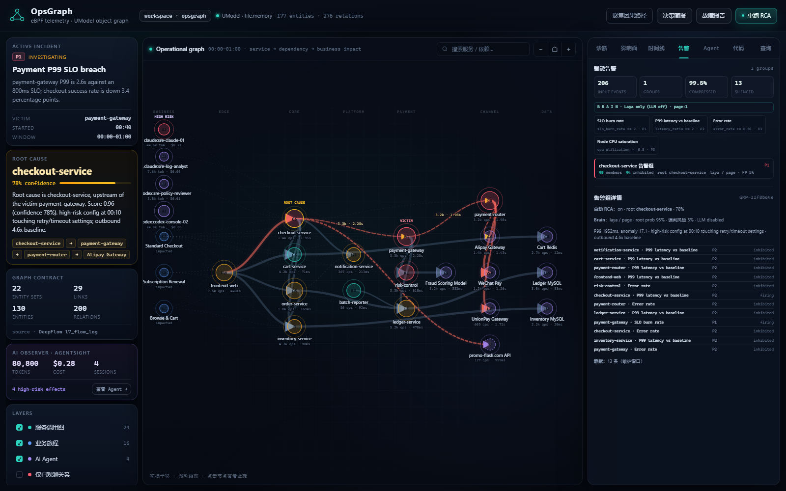

# Laya + LLM 告警大脑

> 降低误判，不是让模型“更聪明地猜”，而是让每个告警都过一遍可解释决策和守卫。



## 为什么需要第二层大脑

告警策略回答“是否超过阈值”，但阈值无法区分：

- `checkout-service` 重试放大导致的 P1；
- node-3 批处理 CPU 92% 的红鲱鱼；
- 下游 5xx 只是根因的传播；
- 一条 LLM 看起来“很确定”但实际上没有图证据的结论。

Laya 负责可解释决策，LLM 只做提议者，最后必须通过图候选和守卫校验。

## Laya 决策模型

实现：[opsgraph/laya.py](../opsgraph/laya.py)，配置：[config/laya_model.json](../config/laya_model.json)。

Laya 把告警组看成两个假设：

```text
root:  组里有真正的服务根因
noise: 红鲱鱼 / 节点单点症状 / 重复告警
```

特征：

```text
graph confidence
service alert (vs node-only)
P1 severity
inhibited ratio
code fix available
```

log-odds：

```text
logit = -0.8
      + 2.8 * confidence
      + 0.8 * service_alert
      + 0.4 * severity_p1
      - 2.4 * node_only
      + 0.3 * inhibited_ratio
      + 0.2 * code_fix
p(root) = sigmoid(logit)
```

动作不是“拍脑袋”，而是最小期望损失：

| 动作 | 漏报成本 | 误报成本 |
|---|---:|---:|
| page | 10 | 0.2 |
| investigate | 4 | 1.0 |
| watch | 12 | 0.2 |
| suppress | 20 | 0 |

守卫：

- `node_only` 不允许 `page`/`investigate`，降为 `watch`；
- P1 在 `p(root) >= 0.4` 时不允许 `suppress`。

实测主告警组：

```json
{
  "source": "laya",
  "root_probability": 0.955,
  "false_alarm_probability": 0.045,
  "action": "page",
  "reasons": ["graph confidence 0.78", "inhibited ratio 0.90", "P1 group", "code fix is available"]
}
```

这比“P1 就 page”多了一层误判抑制，也比纯 LLM 更可解释。

## LLM 提议者

实现：[opsgraph/llm.py](../opsgraph/llm.py)。

LLM 是可选的 OpenAI-compatible chat completions 调用：

```bash
export OPSGRAPH_LLM_URL=https://api.openai.com/v1/chat/completions
export OPSGRAPH_LLM_API_KEY=...
export OPSGRAPH_LLM_MODEL=gpt-4o-mini
export OPSGRAPH_LLM_TIMEOUT=8
python -m opsgraph alerts
```

没有配置 key 时：

```json
{
  "enabled": false,
  "reason": "OPSGRAPH_LLM_URL/API_KEY not configured"
}
```

完全回退到 Laya，不会假装有 LLM。

LLM 只返回严格 JSON：

```json
{
  "root_cause": "checkout-service",
  "confidence": 0.85,
  "false_alarm_probability": 0.12,
  "action": "investigate",
  "reason": "graph and alert agree",
  "citations": ["graph"]
}
```

## 守卫，而不是信任

`opsgraph/brain.py` 校验：

1. `root_cause` 必须来自图候选服务；
2. `action` 只能是 `page/investigate/watch/suppress`；
3. 概率必须在 `0..1`；
4. LLM 根因与高置信图根因不一致 → 不采纳；
5. LLM 想 `suppress` P1 高概率根因 → 降级 `investigate`；
6. 任何异常、超时、非法 JSON → 回退 Laya。

最终告警组带：

```json
{
  "source": "laya+llm",
  "action": "investigate",
  "root_cause": "checkout-service",
  "root_probability": 0.91,
  "false_alarm_probability": 0.12,
  "llm": {"status": "ok", "model": "gpt-4o-mini"}
}
```

或：

```json
{
  "source": "laya",
  "llm": {"status": "guardrailed", "guardrail": "LLM cannot suppress ..."}
}
```

## 使用

```bash
python -m opsgraph alerts
python -m opsgraph brief
python -m opsgraph serve --port 18088
```

控制台「告警」tab 显示：

- `B R A I N · Laya only (LLM off)`；
- 每个组的 `Laya / page · FP 5%`；
- 详情中的 root probability、误判风险、LLM 状态；
- 告警组 RCA 与代码修复数。

## 边界

- Laya 权重是演示配置，生产应按真实误报/漏报成本校准。
- LLM 是提议者，不执行任何工具；没有 key 时完全回退。
- LLM 可能超时/限流；失败不会阻塞告警链路。
- 节点组只能 `watch`，不能凭 CPU 高就 page 支付根因。
