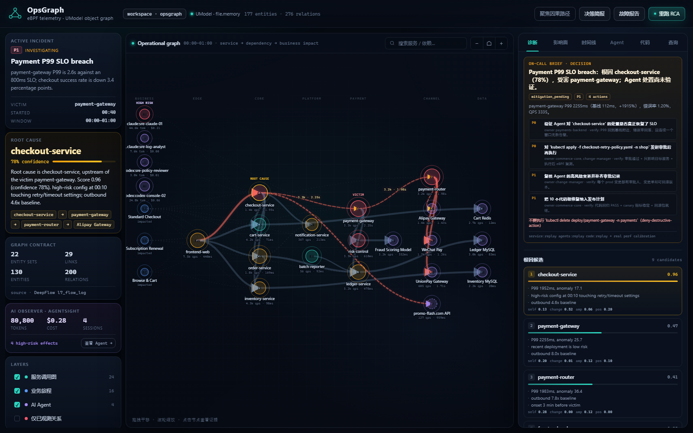

# 值班决策简报

> 产品原则：值班的人不需要第十个仪表盘，需要一句「现在做什么、谁来做、做完看什么」。



## 为什么做

OpsGraph 已经有服务图、Agent 图、代码 RCA、门禁和历史基线。但信号越多，on-call 越容易停在「图很漂亮，下一步呢」。

决策简报把已有证据压缩成一页：

1. **发生了什么**：受害服务、P99/基线/错误率、QPS；
2. **为什么**：根因、置信度、Top 理由；
3. **AI 做了什么**：高风险 session、系统效果、claim 是否一致、处置是否待验证；
4. **下一步**：带 owner、依据、验收标准的 P0/P1 动作；
5. **不要做**：命中 deny 的破坏性动作；
6. **证据来源**：哪些是 replay、哪些是真实 perf、UModel 是否在线。

它不是新的事实源，只是对 `snapshot + analysis + agents + policy + code_rca + code_graph` 的确定性编排。

## 动作生成逻辑

| 条件 | 生成的行动 |
|---|---|
| Agent `remediation_status=pending_validation` | P0 验证 SLO 是否真正恢复 |
| 存在高风险系统效果 | P1 复核变更并补齐审批 |
| 门禁 `require_approval` | P0 发起审批后再执行 |
| 有代码级修复 | P1 纳入发布计划，跑 canary + 回滚包 |
| 以上都没有 | P0 单变量验证根因 |

每条动作都带：

```text
priority / action / owner / because / verify
```

其中 `because` 必须能回到图、Agent 或代码事实；`verify` 必须是可观测的验收条件，不能写「观察一下」。

## 使用

```bash
python -m opsgraph brief
```

生成：

```text
artifacts/brief.json
artifacts/brief.md
```

控制台：

- 诊断 tab 顶部直接显示；
- 顶栏「决策简报」打开 `/api/brief`；
- `GET /api/brief` 返回 Markdown。

`run-demo.ps1` 会在 `code-demo` 之后自动生成简报。

## 示例

```text
Payment P99 SLO breach：根因 checkout-service（78%），受害 payment-gateway；Agent 处置尚未验证。

[P0] 验证 Agent 对 checkout-service 的处置是否真正恢复了 SLO
     owner=payments-backend
     verify=P99 回到基线附近、错误率回落、连续一个窗口无新告警

[P1] 复核 Agent 的高风险变更并补齐审批记录
[P0] 对 kubectl apply retry-policy 发起审批后再执行
[P1] 把 10 个代码级修复纳入发布计划
```

## 边界

- 简报只读已物化 artifacts，不重新跑 RCA；`/api/state` 会实时从当前图状态重建。
- `provenance` 明确标注 replay / real perf；不会把回放说成生产实时。
- 动作是建议，不是自动执行；真正执行仍走 policy gate 和人工审批。
- 代码级修复的 owner 默认取根因服务 owner，生产接入应改为 CODEOWNERS。
