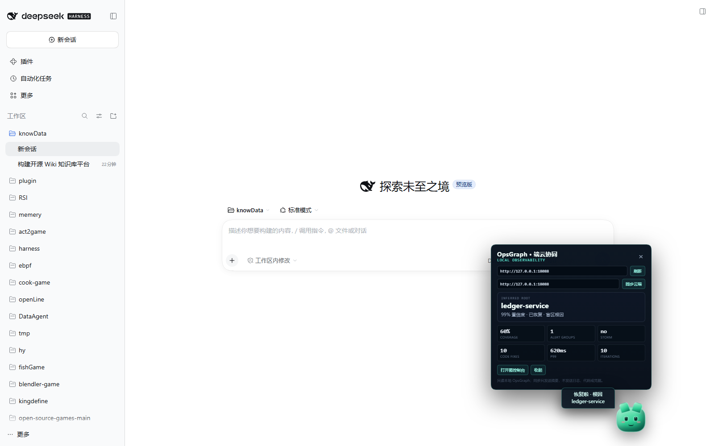
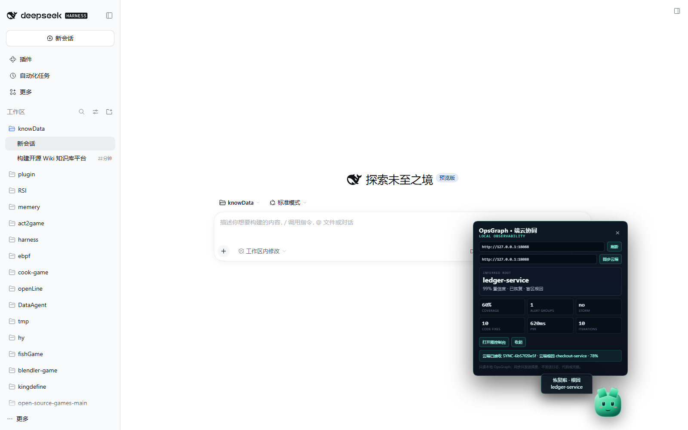

# DSH 本地可观测插件 + 桌面宠物

> 目标：把端侧 DSH 会话、本地 OpsGraph 和云端 RCA 放进同一个可观测面，并让值班状态有一个看得见的“宠物”。



## 包

```text
opsgraph/dsh-plugin/
├── package.json          # dsh.bundle + dsh.client
├── cordis.patch.yml
├── lib/index.js          # host 半场（无依赖）
├── lib/client.js         # lazy-CJS 浏览器半场
└── README.md
```

包名：`dsh-opsgraph-pet`

- **host 半场**只作为 Loader 生命周期锚点，没有工具、没有依赖，避免 linked package 解析失败拖垮插件树。
- **client 半场**注册到 `shell.overlay`，直接读取本地 OpsGraph HTTP API。
- 不在浏览器里执行任何 DSH Host 服务，不读取 DSH 会话内容。

## 功能

### 桌面宠物

常驻 DSH 右下角（DataAgent 宠物左侧），状态随本地 OpsGraph 变化：

| 状态 | 触发 | 表现 |
|---|---|---|
| happy | 根因已恢复 | 绿色、跳跳、气泡“恢复啦 · 根因 ledger-service” |
| storm | `alerts.storm.detected` | 红色、抖动、气泡“告警风暴！206 条 → 1 组” |
| curious | coverage < 70% | 琥珀色、盲区推断中 |
| offline | OpsGraph 不可达 | 灰色、打盹、点击重连 |

点击宠物打开面板：

- 推断根因、置信度、盲区标记；
- coverage、alert groups、storm、code fixes、P99、iterations；
- 本地 / 云端 OpsGraph URL；
- 打开完整图控制台；
- 同步云端。

### 端云协同

`同步云端` 只发送摘要：

```json
{
  "source": "dsh-opsgraph-pet",
  "summary": {
    "root": "ledger-service",
    "confidence": 0.99,
    "coverage_pct": 60,
    "recovered": true,
    "storm": false,
    "alert_input": 206,
    "alert_groups": 1,
    "code_fixes": 10,
    "p99_ms": 620
  }
}
```

云端 OpsGraph 的 `POST /api/coordinate` 接收后：

- 写入 `artifacts/coordination.jsonl`；
- 返回 `request_id`、`cloud_root`、`cloud_confidence`、`cloud_coverage_pct`；
- 宠物面板显示“云端已接收 … · 云端根因 checkout-service · 78%”。



注意：本地推断根因可以是 `ledger-service`，云端图 RCA 是 `checkout-service`；端云结果不一致时**保留两个结论**，不自动覆盖。

## API

OpsGraph console 已增加 CORS：

```text
GET  /api/state        # analysis / alerts / partial / code_rca / brief
POST /api/coordinate   # 接收端侧摘要，返回云端 RCA
OPTIONS /api/*         # CORS preflight
```

CORS 是本机插件直连所需；不要把 18088 暴露到不可信网络。

## 安装

```powershell
dsh plugin --profile web add E:\ebpf\opsgraph\dsh-plugin
```

Desktop profile 由 Electron 管理，直接使用 `dsh plugin` 会被拒绝。当前环境使用：

- `node_modules\dsh-opsgraph-pet` junction 到项目目录；
- `profiles\desktop\package.json` dependency/bundle；
- `profiles\desktop\cordis.patch.yml` 插入 `opsgraph-pet` row。

然后刷新 DSH 页面。先启动 OpsGraph：

```powershell
cd E:\ebpf\opsgraph
python -m opsgraph serve --port 18088
```

## 验证

```text
node --check dsh-plugin/lib/client.js
node --check dsh-plugin/lib/index.js
```

在本机 `web` profile 启动临时 DSH Web：

```powershell
dsh --profile web --port 18099 --no-open
```

Playwright 截图验证：

- 宠物 happy 状态；
- 面板显示 `ledger-service / 99% / 60% coverage / 1 alert group / 620ms / 10 iterations`；
- 点击“同步云端”后收到 `SYNC-...` ack。

实机同步记录：

```text
云端已接收 SYNC-6b57f20e5f · 云端根因 checkout-service · 78%
```

## 边界

- 当前本地/云端数据是 OpsGraph replay + partial demo；生产应替换为真实 gateway。
- 只发送摘要，不发送日志、代码、prompt、token。
- CORS `*` 仅限本机开发；生产应限制 origin 并加认证。
- 桌面 profile 的安装步骤在当前环境完成；换机器需重新 link/junction。
- 宠物状态是 UI 表达，不替代告警和审批。
