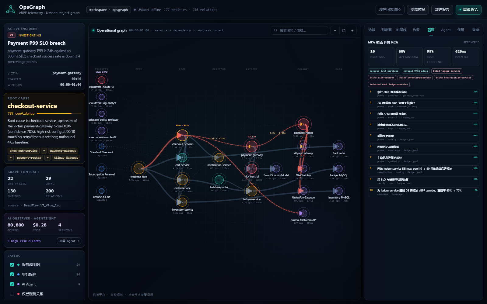

# 60% 覆盖下的 RCA 与恢复

> 当 eBPF 只看得到 60%，最大的风险不是“看不见根因”，而是把“没观测到”误判成“健康”。



## 场景

- 10 个服务，6 个有 eBPF 内部探针：**60%**；
- 15 条依赖边，9 条有 eBPF 流量：**60%**；
- 根因在盲区 `ledger-service`：
  - DB 连接池 `max_pool 50 -> 10` 后耗尽；
  - eBPF 看不到 ledger 内部 DB 调用；
  - APM 能看到 pool active/max、等待时间；
  - 日志能看到 `connection pool exhausted`；
  - 知识库能匹配 `db-pool-exhaustion`。

盲区服务：

```text
ledger-service, risk-control, inventory-service, notification-service
```

## 为什么不能直接看 eBPF 图

如果根因在盲区：

- eBPF 只看到 `checkout -> payment-gateway` 变慢；
- 最容易误判为 `payment-gateway` 自身过载；
- 根因实际在下游未被覆盖的 `ledger-service`；
- 必须用指标、日志、配置 diff、历史知识补足。

## 推断模型

实现：[opsgraph/partial.py](../opsgraph/partial.py)

候选假设：

| hypothesis | service | prior |
|---|---|---:|
| ledger_pool | ledger-service | 0.20 |
| gateway_overload | payment-gateway | 0.25 |
| checkout_retry | checkout-service | 0.20 |
| network_latency | payment-router | 0.20 |
| node_pressure | node-3 | 0.15 |

每次证据用贝叶斯更新：

```text
posterior(h) ∝ prior(h) * likelihood(evidence | h)
```

证据源：

1. 覆盖率审计（盲区不是健康）
2. 已覆盖 eBPF 边
3. APM 指标
4. 日志签名
5. 配置 diff
6. 历史知识签名
7. 主动连接池探针

## 十次迭代

```text
1  coverage-audit   60% 覆盖；ledger 是盲区
2  ebpf-path        只看到 checkout/gateway 慢
3  apm-metrics      ledger pool active=max，wait=420ms
4  log-signature    connection pool exhausted
5  config-diff      max_pool 50 -> 10 at 00:12
6  knowledge-match  命中历史 db-pool-exhaustion
7  pool-probe       主动连接池探针确认
8  remediation      回滚 max_pool 10 -> 50，滚动重启
9  verify           P99 1620 -> 620ms，错误率 1.8% -> 0.4%
10 coverage         增加 DB uprobe；覆盖率 60% -> 70%
```

推理轨迹：

```text
iteration 1: gateway_overload 25%
iteration 2: network_latency 29%
iteration 3: ledger_pool 47%
iteration 4: ledger_pool 77%
iteration 5: ledger_pool 95%
iteration 6: ledger_pool 99%
iteration 7: ledger_pool 99%
```

## 使用

```bash
python -m opsgraph partial-demo
python -m opsgraph brief
python -m opsgraph serve --port 18088
```

产物：

```text
artifacts/partial_rca.json
artifacts/partial-rca.md
```

控制台「盲区」tab 显示：

- 覆盖率 60% / 60%；
- 盲区服务；
- 十次迭代的动作、来源、最高假设、置信度；
- 最终根因 `ledger-service / DB 连接池耗尽`；
- 恢复 P99 620ms，覆盖率补齐到 70%。

## 知识经验

[failure_signatures.json](../data/knowledge/failure_signatures.json) 中的 `db-pool-exhaustion`：

```json
{
  "signals": [
    "pool_active == pool_max",
    "pool_wait_ms > 200",
    "connection timeout in logs",
    "pool max size decreased",
    "service has no eBPF internals"
  ],
  "likelihoods": {"ledger_pool": 0.98}
}
```

知识不是“标准答案”，而是给候选假设一个可审计的似然。

## 边界

- 场景数据是回放 fixture；根因 `root_hint` 只用于测试对照，推断引擎不读取它。
- 生产应接入真实 APM、日志、配置中心、Kubernetes events；当前证据源是适配后的 replay。
- 贝叶斯似然是专家配置，需要按组织事故数据校准。
- 60% 是服务/边覆盖率 fixture，不代表任何真实集群。
- 恢复动作在 demo 中是回滚模拟；生产必须走 policy gate、审批和变更系统。
